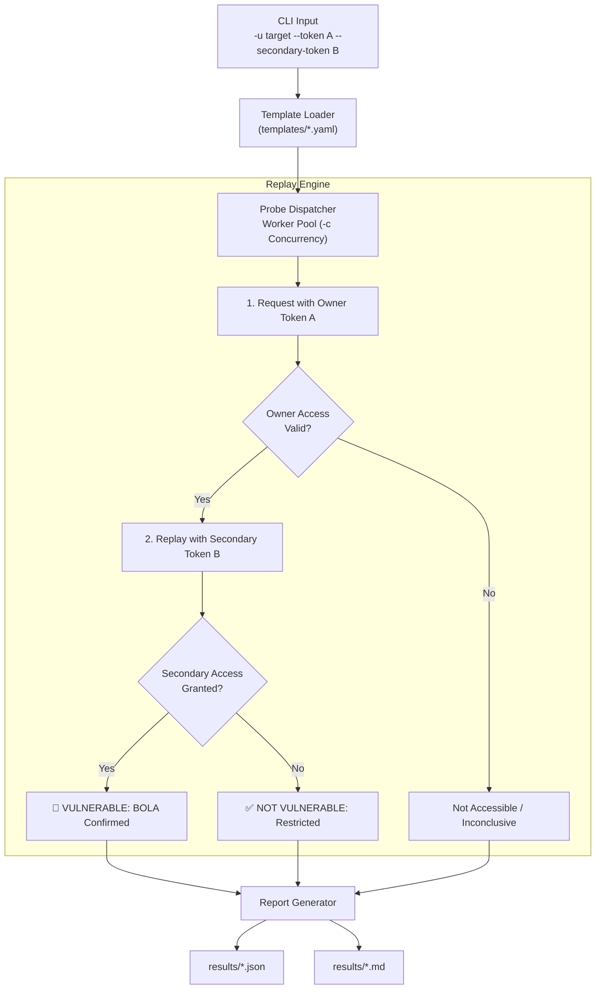

<div align="center">

# ⚡ IDORaider

### High-Performance, Template-Driven BOLA / IDOR Vulnerability Scanner

<p align="center">
  <a href="https://golang.org/"></a>
  <a href="LICENSE"></a>
  
  
</p>

**Built with precision by [JOJIN JOHN](https://github.com/jojin1709)**

<p align="center">
  <strong>IDORaider</strong> hunts Broken Object Level Authorization (BOLA / IDOR) and business-logic flaws across APIs using YAML templates and automated dual-token authorization replay.
</p>

---

</div>

> [!WARNING]
> **Authorized Testing Only:** IDORaider performs active security testing and HTTP replay against target endpoints. Only run this tool against systems you own or have explicit, signed written authorization to test (e.g., bug bounty programs in scope or authorized pentests). Unauthorized testing is illegal.

> [!NOTE]
> **Zero External Dependencies:** Built 100% on the Go standard library. Compiles cleanly offline with zero supply-chain risk and no `go mod download` network requirements.

---

## Table of Contents

- [What is IDORaider?](#what-is-idoraider)
  - [Why IDORaider Exists](#why-idoraider-exists)
  - [How Detection Works](#how-detection-works)
- [Quick Start](#quick-start)
  - [Installation](#installation)
  - [Single-Token Scanning](#single-token-mode-id-enumeration)
  - [Dual-Token BOLA Replay](#dual-token-mode-owner-vs-other--recommended)
- [Key Capabilities](#key-capabilities)
- [CLI Reference](#cli-reference)
- [Writing Scan Templates](#writing-scan-templates)
  - [Template Syntax](#template-syntax)
  - [Included Starter Templates](#included-starter-templates)
- [Architecture & Replay Flow](#architecture--replay-flow)
- [Reporting](#reporting)
- [Developer](#developer)
- [License](#license)

---

## What is IDORaider?

**IDORaider** is an automated, template-driven security scanner designed specifically to discover **Broken Object Level Authorization (BOLA)** and **Insecure Direct Object References (IDOR)** — the #1 API security vulnerability in the OWASP API Security Top 10.

Instead of relying on simple URL fuzzing, IDORaider adopts the methodology used by elite penetration testers and tools like Burp Suite's *Autorize*: it executes requests under verified authentication contexts, validates responses against criteria, and compares access permissions between different user privileges.

### Why IDORaider Exists

* **Zero-Noise Detection:** Single-token scanning flags accessible endpoints, while dual-token replay confirms whether a low-privileged user can view resources owned by another user.
* **Modern Tooling Compatibility:** Built-in Burp Suite proxy routing (`-x`), self-signed TLS support (`-k`), custom session headers (`-H`), and redirect suppression to eliminate false-positive login pages.
* **Fast & Lightweight:** Concurrently replays dozens of endpoints in milliseconds with worker pools and graceful rate-limiting controls.

### How Detection Works

1. **Single-Token Mode (ID Enumeration):**
   Replays requests with your authorized token across candidate IDs. An accessible response (`200 OK` matching content keywords) indicates potential horizontal access without ownership checks.
2. **Dual-Token Mode (Owner vs. Attacker — Recommended):**
   Replays the target endpoint with Token A (Resource Owner) to verify valid access, then immediately replays with Token B (Unrelated Account). If Token B also gains full access to Token A's resource, **BOLA is confirmed**.

---

## Quick Start

### Installation

```bash
# Clone the repository
git clone https://github.com/jojin1709/idoraider.git
cd idoraider

# Build the binary
go build -o idoraider ./cmd/idoraider
```

### Single-Token Mode (ID Enumeration)

Test candidate IDs using your authenticated user token:

```bash
./idoraider -u https://api.target.com -t templates/ -c 20 \
  --token "YOUR_PRIMARY_JWT_TOKEN"
```

### Dual-Token Mode (Owner vs. Other — Recommended)

The gold standard for BOLA testing. Supply two separate accounts you control:

```bash
./idoraider -u https://api.target.com -t templates/ -c 20 \
  --token "ACCOUNT_A_OWNER_TOKEN" \
  --secondary-token "ACCOUNT_B_OTHER_TOKEN"
```

### Routing Through Burp Suite / OWASP ZAP

Inspect all outbound probes directly in your interception proxy:

```bash
./idoraider -u https://api.target.com -t templates/ \
  --token "ACCOUNT_A_TOKEN" \
  --secondary-token "ACCOUNT_B_TOKEN" \
  -x http://127.0.0.1:8080 -k
```

---

## Key Capabilities

* 🔒 **Owner-vs-Other Dual Token Replay**: Automatically proves authorization bypass with two test tokens.
* 🚦 **Redirect Loop Protection**: Does not follow 302 redirects by default, preventing false-positive login pages from triggering alerts.
* 🛡️ **Burp Suite & ZAP Ready**: Route traffic through proxies with `-x` and ignore self-signed certificates with `-k`.
* ⚡ **Zero External Dependencies**: Pure Go standard library. Easy build on Linux, macOS, and Windows.
* 🎛️ **Runtime Candidate ID Override**: Inject target-specific UUIDs or numeric ranges on the fly using `--ids`.
* ⏱️ **Rate Limiting & Delay**: Prevent WAF rate-limiting and account lockout with `-d / --delay`.
* 📊 **Multi-Format Output**: Automatically generates both timestamped structured JSON and ready-to-report GitHub Flavored Markdown files.

---

## CLI Reference

| Flag | Default | Description |
|---|---|---|
| `-u`, `--url` | *(required)* | Target base URL (e.g. `https://api.target.com`) |
| `-t` | `templates/` | Directory containing YAML scan templates |
| `-c` | `20` | Concurrent worker routines |
| `--token` | `$IDORAIDER_TOKEN` | Primary authentication token (owner account) |
| `--secondary-token` | `$IDORAIDER_SECONDARY_TOKEN` | Secondary authentication token (attacker / lower-priv account) |
| `--auth-header` | `Authorization` | Header used to send the token |
| `--auth-scheme` | `Bearer` | Prefix before the token (`""` for raw token/cookies) |
| `-H`, `--header` | — | Custom HTTP request header (`'Key: Value'`), repeatable |
| `-x`, `--proxy` | — | HTTP/HTTPS/SOCKS5 proxy (e.g. `http://127.0.0.1:8080`) |
| `-k`, `--insecure` | `false` | Skip TLS certificate verification |
| `--follow-redirects` | `false` | Follow HTTP redirects (default false to prevent false positives) |
| `-d`, `--delay` | `0s` | Delay between requests for rate limiting (e.g. `50ms`, `1s`) |
| `--ids` | — | Comma-separated list of IDs to probe, overriding template defaults |
| `--timeout` | `10` | Per-request timeout in seconds |
| `-o` | `results/` | Output directory for JSON and Markdown reports |
| `--silent` | `false` | Only print vulnerable findings and final summary |
| `--no-banner` | `false` | Suppress startup banner |

> [!TIP]
> **CI/CD Integration:** IDORaider exits with code `3` if any vulnerability is detected, and `0` when clean, making it simple to break builds on authorization regressions.

---

## Writing Scan Templates

Templates are defined in readable YAML files located in `templates/*.yaml`.

### Template Syntax

```yaml
id: idor-user-profile
name: User Profile IDOR
severity: critical
description: User profile accessible with a modified ID
method: GET
path: /api/v1/users/{id}
headers:
  Authorization: Bearer {token}
  Accept: application/json
ids:
  - 1
  - 2
  - 3
  - 123
match_status:
  - 200
match_words:
  - email
  - username
```

* `path`: `{id}` is replaced with each item in `ids` (or values passed via `--ids`).
* `headers`: `{token}` is replaced with the active token during replay.
* `match_status`: Status codes considered an accessible response.
* `match_words`: Optional keywords that must appear in the body to verify data exposure.

### Included Starter Templates

IDORaider comes pre-packaged with 10 templates covering high-impact attack surfaces:

1. `idor-user-profile.yaml` — User profiles, emails, usernames
2. `idor-admin.yaml` — Administrative control endpoints
3. `idor-order-access.yaml` — E-commerce orders & shipping records
4. `idor-invoice.yaml` — Financial invoices & billing details
5. `idor-message.yaml` — Private direct messages
6. `idor-file.yaml` — Uploaded documents & file storage
7. `idor-project.yaml` — Multi-tenant project data
8. `idor-team.yaml` — Team rosters & workspaces
9. `idor-comment.yaml` — User comments & edit permissions
10. `idor-report.yaml` — Internal generated analytics & exports

---

## Architecture & Replay Flow



---

## Reporting

Reports are saved to `results/` after every run:

1. **JSON Report (`results/*.json`)**: Full programmatic audit data with timestamps, HTTP status codes, request URLs, and exact vulnerability details.
2. **Markdown Report (`results/*.md`)**: Clean GitHub Flavored Markdown summary with status badges and finding tables ready for pentest deliverables and bug bounty submissions.

---

## Developer

Developed with ❤️ by **JOJIN JOHN**.

* **Author:** Jojin John
* **GitHub:** [@jojin1709](https://github.com/jojin1709)
* **Project:** [IDORaider](https://github.com/jojin1709/idoraider)

---

## License

This project is licensed under the [MIT License](LICENSE).
